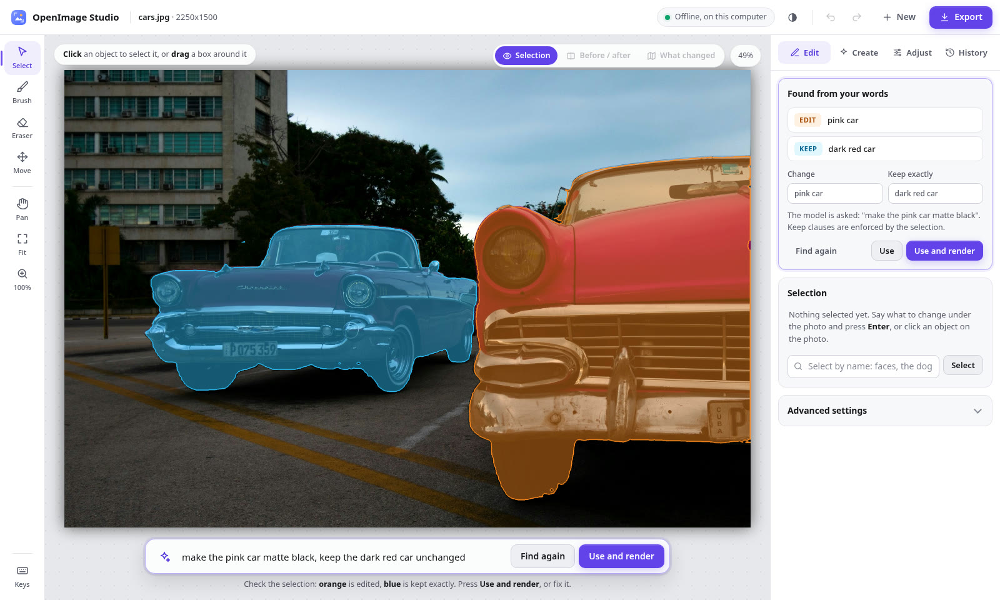
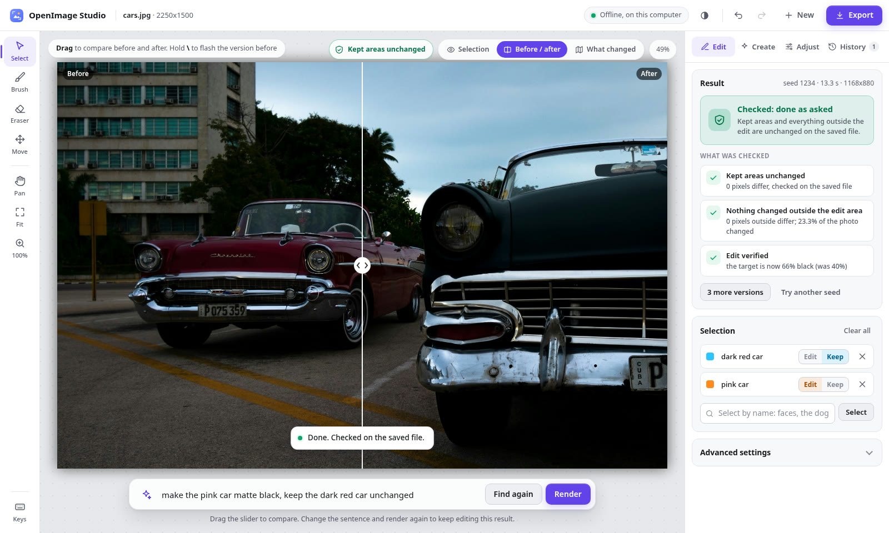

# OpenImage Studio

Edit a photo by saying what to change: "make the pink car matte black, keep the dark red car
unchanged". OpenImage Studio finds the objects you name, shows what it will edit (orange) and
what it will keep exactly (blue), edits on your own GPU, and checks the result on the saved
file: the kept areas and everything outside the edit area are proven unchanged, pixel for
pixel. Nothing leaves the computer: not the photo, the words, the selections or the results.

Built on Meta SAM 3 (finding objects from words), Meta SAM 2.1 (clicks and boxes) and
FLUX.2 [klein] 4B (editing), all run locally.



## Built during the hackathon

All the code here was written from 3 to 4 November 2026, during the Meta Global AI Developer
Hackathon. The models are not ours: SAM 3 and SAM 2.1 are Meta's, FLUX.2 [klein] 4B is Black
Forest Labs', and Grounding DINO is the fallback when SAM 3 is not installed. What we built:

- **Selection from words** (`lis/ground.py`): the sentence is split into what to change and
  what to keep; each phrase becomes a SAM 3 concept prompt; instances are ranked by the colour
  words and by position or relation ("the car on the left", "the cup next to the laptop"); a
  target that lies inside a kept object is refused with a reason.
- **The pixel proof** (`lis/composite.py`, `lis/verify.py`): kept pixels are copied from the
  image on screen into the result and compared on the saved file before export; nothing
  outside the edit area may change. A result that fails is never shown as a success.
- **Moves that take the shadow along** (`lis/shadow.py`): SAM 3 finds the object's shadow, the
  model removes both, and the shadow is carried as a dimming of the ground at the new place.
- **The edit plan and history** (`lis/engine.py`, `lis/policy.py`, `lis/history.py`): every
  edit is an explicit plan of selection, instruction and kept areas, with undo, redo and
  branching.
- **The editor** (`lis/web.py`, `lis/static/`): a local web app with no libraries and nothing
  fetched from the internet, and memory profiles that fit smaller GPUs (`lis/profiles.py`).

## Install

Linux with an NVIDIA GPU (driver 550 or newer) and about 26 GB of free disk.

```bash
git clone https://github.com/Thamirawaran/OpenImage-Studio && cd OpenImage-Studio
scripts/install.sh
```

The installer checks the machine, installs Python 3.12 and PyTorch for CUDA 12.8 with `uv`,
downloads the models once (about 19 GB: FLUX.2 Klein 4B, SAM 2.1, Grounding DINO), checks them
against the hashes in `assets/manifest.json`, runs the tests and adds OpenImage Studio to the
application menu. Running it again skips what is done.

For selection from words with SAM 3 (recommended): request access at
https://huggingface.co/facebook/sam3, run `.venv/bin/hf auth login`, then
`scripts/install.sh --with-sam3`.

## Start

```bash
./studio --open        # opens http://127.0.0.1:7860 in the browser
./studio --lan         # also lets a phone or another computer on the same network open it
```

The page says "Loading models" for about a minute, then "Offline, on this computer". With
`--lan` the terminal prints an address ending in `?key=...`; only devices that open it get in.
Work is saved as you go, and Recent on the start page reopens a photo with its versions.

## Using it

1. **Open a photo**: drop it on the page, paste it, or press Choose a photo (JPEG, PNG, HEIC,
   WebP, TIFF, BMP), or make one from words on the start page.
2. **Say what to change**, and what must stay: "remove the potted plant, keep the sofa
   unchanged". Press **Enter**. Or click an object and choose **Change this** or **Keep this
   exactly**.
3. **Check the plan**: orange is edited, blue is kept exactly. Fix it with a click, a box or
   the brush if needed.
4. **Use and render**. The result shows its checks; drag across the photo to compare, and
   **What changed** shows the change map.
5. **Keep editing**, go back in **History**, and **Export** a PNG (checked again) or a JPEG.



What it can do:

- Recolour, change a material, remove, add, restyle, replace the background, or change the
  whole photo ("make it look like winter") while keeping what you name exactly.
- Edits of people: hats, glasses, clothes, hair, a smile, a new pose.
- Move an object by dragging it; its shadow moves with it.
- Make pictures from words, or from one or two photos ("the same person on a beach").
- Extend a photo past its edges; adjust brightness, contrast, saturation and warmth; rotate,
  flip and crop.

Keys: S select, B brush, E eraser, C compare, M what changed, Ctrl+Z undo, ? for the full list.

## Hardware

`./studio` picks a memory profile from the free video memory: it keeps the models on the GPU
when they fit and streams them from system memory when they do not, with the same output. On an
RTX 3090 an edit takes about 8 to 20 s. Below 12 GB of video memory a small-GPU mode moves the
selection models off the GPU while rendering; it was tested only by limiting memory on a 24 GB
card, so a real 4 to 8 GB card is untested. Windows (WSL 2) is untested; macOS is not
supported (no CUDA).

## Offline

The editor loads only local files, serves everything the page uses itself, and answers only
at 127.0.0.1 unless `--lan` is given. `scripts/offline_check.sh` runs a real edit inside a
Linux network namespace that has only the loopback interface, to prove nothing is needed from
the network.

## Known limits

Text inside pictures and removing small or thin things are the weakest edits. The sentence
parser is rules, so unusual phrasing can be misread; the plan shows what it understood, and it
can be corrected. A single click can pick only part of an object; a box or a second click
fixes it.

## Tests

```bash
.venv/bin/python -m pytest -q tests     # 97 tests, no GPU needed
```

## Licences

This code: Apache 2.0 (`LICENSE`), copyright 2026 Thamirawaran Sathiyalogeswaran.
FLUX.2 [klein] 4B: Apache 2.0. SAM 2.1: Apache 2.0. SAM 3: Meta SAM License (gated; accept it
on Hugging Face). Grounding DINO: Apache 2.0. `samples/cars.jpg` is from the Meta SAM 2
repository; the other samples are generated and show no real people.
